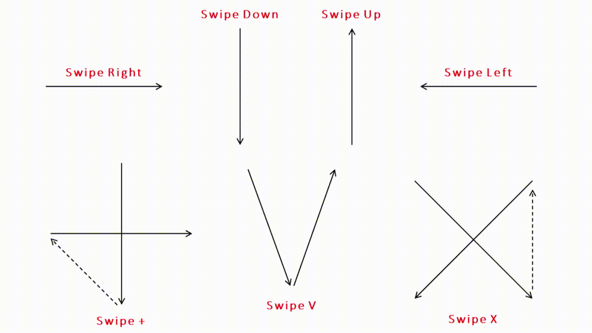

<p align="right">
 <!-- badges currently not working because the repository is private -->
&nbsp;
&nbsp;
&nbsp;
</p>

# 📦 Archived: No Longer Maintained

This repository has been archived and is no longer maintained. It is now read-only. Feel free to fork or use it as needed.

# e2eET Skeleton Based HGR Using Data-Level Fusion

This repository holds the PyTorch/FastAI implementation for **"Skeleton Based Hand Gesture Recognition Using Data Level Fusion"**.
Alternatively, this **[drive folder](https://drive.google.com/drive/folders/1BvoxkRDBK86A3_oNdQrnC8TLvp4l0W9x)** mirrors this repository but also contains the preprocessed .pckl files and generated .rar spatiotemporal datasets that are otherwise too large to be uploaded here.

The proposed hand gesture recognition (HGR) framework transforms the dynamic hand gesture recognition task into a static image classification task using data-level fusion and a custom ensemble tuner multi-stream CNN architecture.
For technical details, please refer to the following publication(s):

> **Development of a Lightweight Real-Time Application for Dynamic Hand Gesture Recognition** <br>
> *Oluwaleke Umar, Maki Habib* &mdash; [[IEEE ICMA Conference Paper](https://ieeexplore.ieee.org/document/10216066)]
>
> **Transforming Hand Gesture Recognition Into Image Classification Using Data Level Fusion** <br>
> *Oluwaleke Umar, Maki Habib, Mohamed Moustafa* &mdash; [[IGI Book Chapter](https://doi.org/10.4018/978-1-6684-7791-5.ch003)]
>
> **Real-Time Hand Gesture Recognition: Integrating Skeleton-Based Data Fusion and Multi-Stream CNN** <br>
> *Oluwaleke Umar, Maki Habib, Mohamed Moustafa* &mdash; [[ArXiv Preprint](https://arxiv.org/abs/2406.15003)]

A real-time HGR application developed based on our framework only requires video streams from any standard inbuilt PC webcam and operates with a minimal CPU and RAM footprint, as shown in the [application memory utilisation image](./docs/Application-Memory-Utilization.png).
The application underscores the utility of our proposed framework for reducing the hardware requirements and computational complexity of the HGR task on a standard PC while achieving acceptable latency, frames-per-second, and classification accuracy.

<p align="center">
  
</p>


## Prerequisites

- Python 3.12
- [uv](https://docs.astral.sh/uv/)
- An NVIDIA GPU with a driver supporting CUDA 12.4 for model training (the real-time demo can run on CPU or GPU)

Create the environment from the repository root:

```bash
uv sync
```

The dependencies are declared in `pyproject.toml` and pinned in `uv.lock`. `uv run` finds the root project from any subdirectory.


## Data-Level Fusion: Processing Benchmark Datasets

1. **Consiglio Nazionale delle Ricerche (CNR) Hand Gestures Dataset**
   - Download the [CNR dataset](https://github.com/aviogit/dynamic-hand-gesture-classification-datasets/tree/master/dynamic-hand-gestures-new-CNR-dataset-2k-images) and extract to the directory `./datasets/CNR/`.
   - Generate the spatiotemporal dataset by running the notebook `./data-pipeline/parseData-CNRd.ipynb`. This will create randomized training and validation subsets from the original dataset. The spatiotemporal dataset will be saved to `./image-datasets/CNR-3d-original-1920px.1080px-[topdown]/`.

2. **Leap Motion Dynamic Hand Gesture (LMDHG) Database**
   - Download the [LMDHG dataset](https://www-intuidoc.irisa.fr/en/english-leap-motion-dynamic-hand-gesture-lmdhg-database/) and extract to the directory `./datasets/LMDHG/`.
   - Preprocess the dataset by running the notebook `./data-pipeline/parseData-LMDHGd.ipynb`. This will create a file `./datasets/LMDHG_3d_dictPaperSplit_l750_s609.pckl`.
   - Generate the spatiotemporal dataset using `uv run python data-pipeline/createImages_LMDHGd_mVOs.py -c "data-pipeline/configs/LMDHG.default.json"`. The spatiotemporal dataset will be saved to `./image-datasets/LMDHG.mVOs-dictPaperSplit-3d.V1-noisy(raw).960px-[allVOs].adaptive-mean`.

3. **First-Person Hand Action (FPHA) Benchmark**
   - Download the [FPHA dataset](https://guiggh.github.io/publications/first-person-hands/) and extract to the directory `./datasets/FPHA/`.
   - Preprocess the dataset by running the notebook `./data-pipeline/parseData-FPHAd.ipynb`. This will create a file `./datasets/FPHA_3d_dictPaperSplit_l250_s1175.pckl`.
   - Generate the spatiotemporal dataset using `uv run python data-pipeline/createImages_FPHAd_mVOs.py -c "data-pipeline/configs/FPHA.default.json"`. The spatiotemporal dataset will be saved to `./image-datasets/FPHA.mVOs-dictPaperSplit-3d.V1-noisy(raw).960px-[allVOs].adaptive-mean`.

4. **3D Hand Gesture Recognition Using a Depth and Skeleton Dataset (SHREC2017)**
   - Download the [SHREC2017 dataset](http://www-rech.telecom-lille.fr/shrec2017-hand/) and extract to the directory `./datasets/SHREC2017/`.
   - Preprocess the dataset by running the notebook `./data-pipeline/parseData-SHREC2017d.ipynb`. This will create a file `./datasets/SHREC2017_3d_dictTVS_l250_s2800.pckl`.
   - To generate the 14G and 28G spatiotemporal datasets:
      - Modify line 23 in `./data-pipeline/configs/SHREC2017.default.json` such that `"n_dataset_classes": 14,` for 14G evaluation mode or `"n_dataset_classes": 28,` for 28G evaluation mode.
      - Execute `uv run python data-pipeline/createImages_SHREC2017d_mVOs.py -c "data-pipeline/configs/SHREC2017.default.json"`.
   -  The 14G and 28G spatiotemporal datasets will be saved to `./image-datasets/SHREC2017.mVOs-3d.14g-noisy(raw).960px-[allVOs].adaptive-mean` and `./image-datasets/SHREC2017.mVOs-3d.28g-noisy(raw).960px-[allVOs].adaptive-mean` respectively.

5. **Dynamic Hand Gesture 14/28 (DHG1428) Dataset**
   - Download the [DHG1428 dataset](http://www-rech.telecom-lille.fr/DHGdataset/) and extract to the directory `./datasets/DHG1428/`.
   - Preprocess the dataset by running the notebook `./data-pipeline/parseData-DHG1428d.ipynb`. This will create a file `./datasets/DHG1428_3d_dictTVS_l250_s2800.pckl`.
   - To generate the 14G and 28G spatiotemporal datasets:
      - Modify line 23 in `./data-pipeline/configs/DHG1428.default.json` such that `"n_dataset_classes": 14,` for 14G evaluation mode or `"n_dataset_classes": 28,` for 28G evaluation mode.
      - Execute `uv run python data-pipeline/createImages_DHG1428d_mVOs.py -c "data-pipeline/configs/DHG1428.default.json"`.
   -  The 14G and 28G spatiotemporal datasets will be saved to `./image-datasets/DHG1428.mVOs-3d.14g-noisy(raw).960px-[allVOs].adaptive-mean` and `./image-datasets/DHG1428.mVOs-3d.28g-noisy(raw).960px-[allVOs].adaptive-mean` respectively.

6. **SBU Kinect Interaction Dataset (SBUKID)**
   - Download the clean version of the [SBUKID dataset](https://vision.cs.stonybrook.edu/~kiwon/Datasets/SBU_Kinect_Interactions/README.txt) and extract the zipped files to the directory `./datasets/SBUKId/`.
   - Preprocess the dataset by running the notebook `./data-pipeline/parseData-SBUKId.ipynb`. This will create a new folder `./datasets/SBUKId.txts/` and five files `./datasets/SBUKId_3D_dictCVS_f0{1,2,3,4,5}_s282.pckl`.
   - To generate the five cross-validation spatiotemporal datasets:
      - Modify lines 43 and 44 in `./data-pipeline/configs/SBUKId.default.json` to specify the cross-validation fold i.e. `f01` and `F01` for the first cross-validation fold, `f02` and `F02` for the second cross-validation fold, and so on.
      - Execute `uv run python data-pipeline/createImages_SBUKId_mVOs.py` five times, updating the configuration for each cross-validation fold.
   - There should be five cross-validation spatiotemporal datasets saved to `./image-datasets/SBUKId-3D-CVS.F0{1,2,3,4,5}.8G-norm.960px-[allVOs.adaptiveMean]`.
   - To verify that the cross-validation spatiotemporal datasets have been generated correctly, you can run `./data-pipeline/verifyImages-SBUKId.ipynb`.

*NOTE: The parameters required to generate the spatiotemporal datasets are set in the `*.default.json` files. See `./data-pipeline/configs/defaultConfigs.schema.json` for details about the parameters.*

> **Alternatively, the preprocessed .pckl files and generated spatiotemporal datasets can be downloaded from this [drive folder](https://drive.google.com/drive/folders/1BvoxkRDBK86A3_oNdQrnC8TLvp4l0W9x) and extracted to the corresponding `./datasets` and `./image-datasets` directories.**


## Model Training & Evaluation

The directory `./experiments` contains the training and evaluation code for all benchmark datasets. The [`./runs` directory](./runs/) contains TensorBoard event archives linked to their corresponding result logs; see its [archive guide](./runs/README.md) for details.
The arguments required for model training are set at the command line. See `./experiments/src/trainingParameters.schema.json` for details about the parameters. Run the training commands from `./experiments`.

*NOTE: Before training, ensure that the `datasetDirectories` object in `./experiments/src/helperFunctions.py` points to the correct directories for the spatiotemporal datasets generated above and located at `./image-datasets` such that:*

```python
datasetDirectories = {
   "CNR16": "CNR-3d-original-1920px.1080px-[topdown]",
   "LMDHG13": "LMDHG.mVOs-dictPaperSplit-3d.V1-noisy(raw).960px-[allVOs].adaptive-mean",
      ...
      ...
      ...
   "SBUKID.F058": "SBUKId-3D-CVS.F05.8G-norm.960px-[allVOs.adaptiveMean]",
}
```

### Single-Stream (1SA) & Two-Stream (2SA) Experiments

`./experiments/sVO.mVO.Checkpoints.py` contains the code for testing the effect of different view orientations in the spatiotemporal datasets generated on classification accuracy of different datasets.

The notebook `./experiments/sVO.mVO.Checkpoints.ipynb` contains the necessary command line inputs while the [results log](./results/sVO.mVO.Checkpoints.log) contains the recorded results of extensive 1SA and 2SA experiments for all datasets. New run logs are written under `./experiments/outputs/`; they do not update the checked-in results log. The corresponding TensorBoard event archive is `./runs/sVO.mVO.Checkpoints.zip`.

The SBUKId single-stream checkpoint runs cover six view orientations across five cross-validation folds. Their TensorBoard events are in `./runs/SBUKId.sVO.Checkpoints.zip`, with the corresponding accuracies in the [SBUKId results log](./results/SBUKId.sVO.Checkpoints.log).

**EX1 &ndash;**
1SA experiment on `DHG1428` with `14` classes using `top-down` view orientation running on GPU `0`:
```bash
uv run python sVO.mVO.Checkpoints.py -IG 0 -nC 14 -mVOs top-down -dsN DHG1428
```

**EX2 &ndash;**
2SA experiment on `DHG1428` with `28` classes using `custom` and `side-left` view orientations (order-sensitive) running on GPU `1`:
```bash
uv run python sVO.mVO.Checkpoints.py -IG 1 -nC 28 -mVOs custom side-left -dsN DHG1428
```

### Multi-Stream Ensemble Tuner Experiments

`./experiments/mVO.e2eEnsembleTuning.py` contains the code for training the spatiotemporal datasets using the custom Ensemble Tuner Multi-Stream CNN Architecture shown in the figure above.

The notebook `./experiments/mVO.e2eEnsembleTuning.ipynb` contains the necessary command line inputs while the [results log](./results/mVO.e2eEnsembleTuning.log) contains the recorded results of extensive 1SA, 2SA and 3SA experiments to find the optimal combination and ordering of mVOs for all datasets. New run logs are written under `./experiments/outputs/`; they do not update the checked-in results log. The corresponding TensorBoard event archive is `./runs/mVO.e2eEnsembleTuning.zip`.

**EX &ndash;**
3SA experiment on `DHG1428` with `14` classes using `top-down`, `custom` and `front-away` view orientation running on GPU `0`:
```bash
uv run python mVO.e2eEnsembleTuning.py -IG 0 -nC 14 -mVOs top-down custom front-away -dsN DHG1428 -IISE 0 -ISIS 0
```

### Final Evaluation on Benchmark Datasets

The final evaluation for each benchmark dataset was carried out with the optimal combination and ordering of mVOs, along with training schedules.
The files `./results/allDatasets-e2eEnsembleTuning-Summary.xlsx` and its companion [summary log](./results/allDatasets-e2eEnsembleTuning-Summary.log) summarize how the final classification accuracies were obtained.

To reproduce the evaluation results reported in the paper, the notebook `./experiments/allDatasets-e2eEnsembleTuning-Evaluation.ipynb` contains the necessary command line inputs while the [evaluation log](./results/allDatasets-e2eEnsembleTuning-Evaluation.log) contains the evaluation results. The corresponding TensorBoard event archive is `./runs/allDatasets-e2eEnsembleTuning-Evaluation.zip`.

<!-- ˄˅↑↓ -->
| Benchmark Dataset | Classification Accuracy (%) |
| ----------------- | :-------------------------: |
| CNR               | 97.05 <sub>**↓1.73**</sub>  |
| LMDHG             | 98.97 <sub>**↑5.16**</sub>  |
| FPHA              | 91.83 <sub>**↓4.10**</sub>  |
| SHREC2017 (14G)   | 97.86 <sub>**↑0.24**</sub>  |
| SHREC2017 (28G)   | 95.36 <sub>**↓0.47**</sub>  |
| DHG1428 (14G)     | 95.83 <sub>**↓2.27**</sub>  |
| DHG1428 (28G)     | 92.38 <sub>**↓1.82**</sub>  |
| SBUKID            | 93.96 <sub>**↓4.34**</sub>  |
<!-- ˄˅↑↓ -->


## Live Real-Time HGR Application

<p align="center">
  
</p>

The real-time application recognizes the `Swipe- { Up | Down | Right | Left | + | V | X }` gestures from the DHG1428 dataset in both 14G/28G modes, i.e., the gestures can be performed using either one finger or the whole hand.

The [DHG1428 gesture diagram](./docs/DHG1428-Swipe-Gestures.png) shows how to perform the gestures, as in the original dataset. The [demo video](./docs/HGR-Live-Demo-Video.mp4) shows the application recognising all the `Swipe` gestures in one take.

> **The real-time application REQUIRES trained (.pkl) models which can be downloaded from this [drive folder](https://drive.google.com/drive/folders/1BvoxkRDBK86A3_oNdQrnC8TLvp4l0W9x) and extracted to the `./gesture-recognition/models` directory.**

The demo is organized as follows:

```text
gesture-recognition/
├── allConfigs.jsonc
├── liveStreamHGR.py
├── models/          # trained .pkl models, ignored by Git
├── outputs/         # generated sequences, logs and archives, ignored by Git
└── src/             # demo modules
```

To launch the real-time HGR application from the terminal, change your directory to `./gesture-recognition` and run `uv run python liveStreamHGR.py`. The demo runs on CPU when `cpu_mode` is true in `./gesture-recognition/allConfigs.jsonc`, and uses the GPU when it is false. If CUDA is unavailable, it falls back to CPU automatically.

When all the required modules have been initialized (takes a little longer the first time), the terminal output should read:
```bash
cd gesture-recognition
uv run python liveStreamHGR.py
INFO: Initialized <vispyOutputGUI.py> ...
INFO: Initialized <dataLevelFusion.py> ...
INFO: Initialized <liveStreamHGR.py> ...
INFO: Created TensorFlow Lite XNNPACK delegate for CPU.
INFO: dls.vocab=[0.Swipe+ 1.SwipeDown 2.SwipeLeft 3.SwipeRight 4.SwipeUp 5.SwipeV 6.SwipeX]
INFO: Initialized <gestureClassInference.py> ...
```

<br>

When all the application modules have initialized, with the three windows shown in the [application window image](./docs/Initialized-Application-Windows.png), keep the camera window focused and:

1. raise your hand in view of the camera and wait until a skeleton is overlaid on your hand <br> *(the skeleton overlay shows that the gesture sequence is being recorded)*
2. perform any of the `Swipe` gestures while maintaining the skeleton overlay, as shown in the [gesture diagram](./docs/DHG1428-Swipe-Gestures.png)
3. press `Space` to end the current gesture sequence and trigger data-level fusion and classification
4. the gesture inferences are displayed in the output GUI and command line <br> *(all inferences are appended to `./gesture-recognition/outputs/history.log`)*
5. press `C` to clear the current gesture sequence without classifying it
6. press `Esc` to exit the application and terminate its child processes

When `debug_mode` is enabled in `./gesture-recognition/allConfigs.jsonc`, the fusion window additionally supports `Left`/`Right` to change view orientation, `Space` to pause or resume the visualisation, and `C` to print camera details. The output window supports `C` for scene details and `Esc` to quit.

<p align="center">
  
</p>

### Demo Dataset & Model Training

The optional seven-class demo dataset is generated from the 14G DHG1428 spatiotemporal dataset. Extract `DHG1428.mVOs-3d.14g-noisy(raw).960px-[allVOs].adaptive-mean.rar` into `./image-datasets`, then run:

```bash
cd gesture-recognition
uv run python -m src.createDemoDataset
uv run python -m src.ensembleTunerTraining -IG 0 --n_classes 7 -IE 30 -IISE 0 -ISE 10 -ISIS 276 328 -CEMC -CETE
```

`createDemoDataset` writes `./image-datasets/DHG1428.liveStream-3D.7G-[custom.topdown.frontaway]`. Training writes the model and checkpoints to `./models` and appends run logs to `./outputs/ensembleTunerTraining.log`. The notebook `./ensembleTunerTraining.ipynb` contains the same commands.

<hr>


## Citation

If you find this work contained in this repository useful in your research, please cite the following publication(s) as relevant:

```bibtex
@INPROCEEDINGS{10216066,
  author={Yusuf, Oluwaleke and Habib, Maki},
  booktitle={2023 IEEE International Conference on Mechatronics and Automation (ICMA)},
  title={Development of a Lightweight Real-Time Application for Dynamic Hand Gesture Recognition},
  year={2023},
  pages={543-548},
  doi={10.1109/ICMA57826.2023.10216066}}

```

```bibtex
@incollection{
   author = {Yusuf, Oluwaleke Umar and Habib, Maki K. and Moustafa, Mohamed N.},
   title = {Transforming Hand Gesture Recognition Into Image Classification Using Data Level Fusion: Methods, Framework, and Results},
   booktitle = {Global Perspectives on Robotics and Autonomous Systems: Development and Applications},
   editor = {Habib, Maki K.},
   pages = {39--78},
   publisher = {IGI Global},
   year = {2023},
   doi = {10.4018/978-1-6684-7791-5.ch003},
}
```

<hr>
